<a id="readme-top"></a>

<div align="center">

<a href="https://adityasidham.site">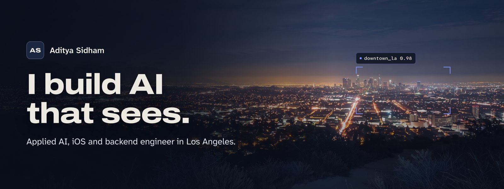</a>

<br>

[](https://adityasidham.site)
[](assets/resume/Aditya_Sidham_Resume.pdf)
[](https://www.linkedin.com/in/adityasidham/)
[](https://www.strava.com/athletes/186930143)


**[Live site](https://adityasidham.site)** &nbsp;|&nbsp; **[Selected work](#selected-work)** &nbsp;|&nbsp; **[How the hero works](#how-the-hero-works)** &nbsp;|&nbsp; **[Receipts](#receipts)** &nbsp;|&nbsp; **[Run it locally](#run-it-locally)**

</div>

<br>

<p align="center">
  <a href="https://adityasidham.site">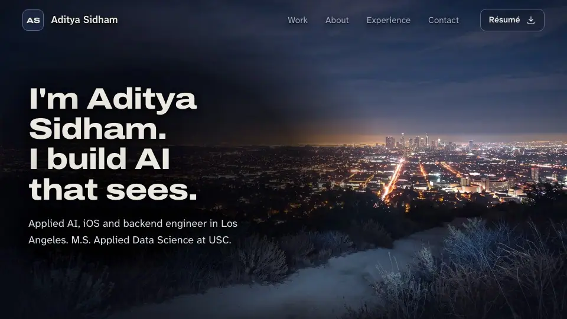</a>
  <br>
  <sub>Scroll the hero and a camera pushes through six Runway stills, locking onto each target before it moves.</sub>
</p>

## About

I'm Aditya Sidham, an applied AI, iOS and backend engineer in Los Angeles, finishing an M.S. in Applied Data Science at USC in December 2026. I build AI that sees, and I take it past the demo: a patent-pending form coach, a four-agent nutrition app, and a database you can ask in plain English.

This repository is my portfolio. I wrote it from scratch in plain HTML, CSS and JavaScript. No framework, no build step to view it, nothing to install.

<details>
<summary><b>Table of contents</b></summary>

<br>

- [About](#about)
- [Selected work](#selected-work)
- [How the hero works](#how-the-hero-works)
- [Inside the site](#inside-the-site)
- [Design system](#design-system)
- [Receipts](#receipts)
- [Tech stack](#tech-stack)
- [Project structure](#project-structure)
- [Run it locally](#run-it-locally)
- [Credits](#credits)
- [Contact](#contact)

</details>

## Selected work

Every project leads with what shipped, my role, and the numbers. Each card opens the full case study.

<table>
  <tr>
    <td width="50%" valign="top">
      <a href="https://adityasidham.site/FitandFine.html">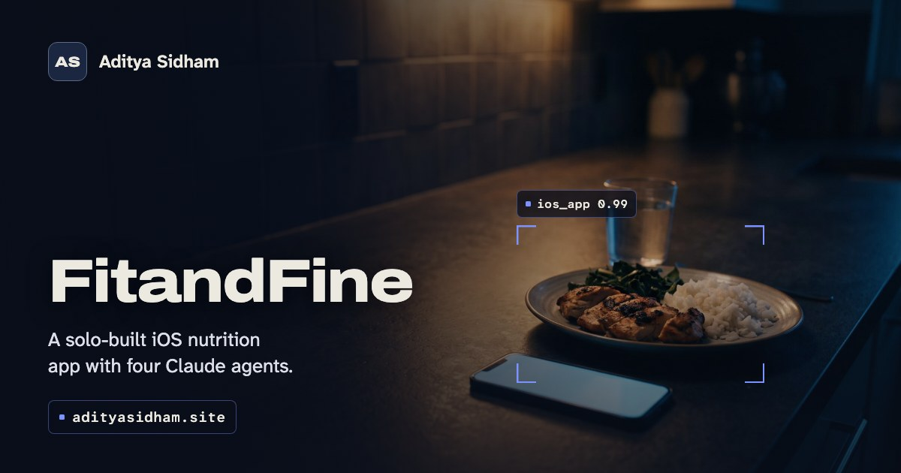</a>
      <h3>FitandFine</h3>
      <sub><b>Flagship, 2026, solo build</b></sub>
      <p>A native iOS nutrition app that learns from what you actually do. SwiftUI app, FastAPI backend, label scanning and four AI agents. Barcode to food card in under 500 ms across 50,000+ USDA foods, over 85% label-field accuracy, 85% backend test coverage.</p>
      <p><a href="https://github.com/AdityaSidham/FitandFine">Code</a> &nbsp;|&nbsp; <a href="https://adityasidham.site/FitandFine.html">Case study</a></p>
    </td>
    <td width="50%" valign="top">
      <a href="https://adityasidham.site/FitForm.html">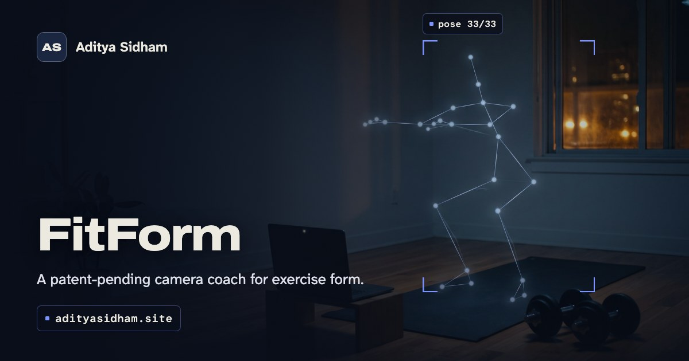</a>
      <h3>FitForm</h3>
      <sub><b>Computer vision, 2024, patent-pending</b></sub>
      <p>A camera that counts a rep only when the form is right. Tracks 33 body landmarks at 25 FPS on a laptop CPU, with 30% fewer false rep counts across 120 annotated clips. Published Indian patent application 202421099595, where I'm a co-applicant.</p>
      <p><a href="https://github.com/AdityaSidham/FitformAPP">Code</a> &nbsp;|&nbsp; <a href="https://adityasidham.site/FitForm.html">Case study</a></p>
    </td>
  </tr>
  <tr>
    <td width="50%" valign="top">
      <a href="https://adityasidham.site/ChatDB.html">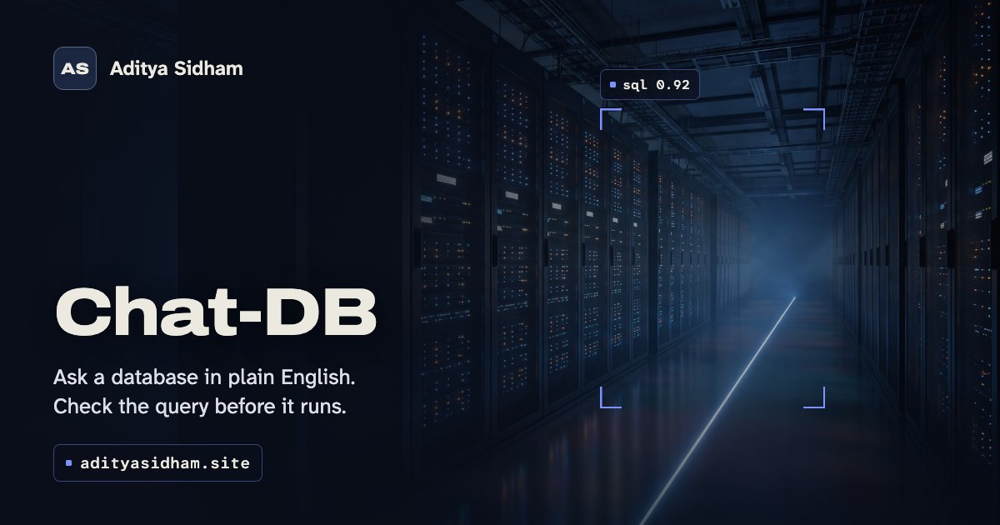</a>
      <h3>Chat-DB</h3>
      <sub><b>LLM application, 2025, team lead of four</b></sub>
      <p>Ask MySQL or MongoDB a question in plain English and see the exact query it ran. About 60% faster query writing, 92% correct on a 150-question test suite, 12 regressions caught before release.</p>
      <p><a href="https://github.com/AdityaSidham/Chat-DB">Code</a> &nbsp;|&nbsp; <a href="https://adityasidham.site/ChatDB.html">Case study</a></p>
    </td>
    <td width="50%" valign="top">
      <a href="https://adityasidham.site/FireandSmokeDetectionPage.html">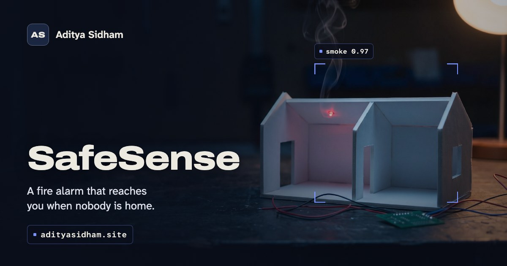</a>
      <h3>SafeSense</h3>
      <sub><b>IoT, 2023, CIIA finalist</b></sub>
      <p>A fire alarm that reaches you when nobody is home. ESP8266 sensing, a local alarm, and GSM and Wi-Fi alerts that fire in parallel. I led the team of four to the finals.</p>
    </td>
  </tr>
  <tr>
    <td width="50%" valign="top">
      <a href="https://adityasidham.site/FaceandHanddetection.html">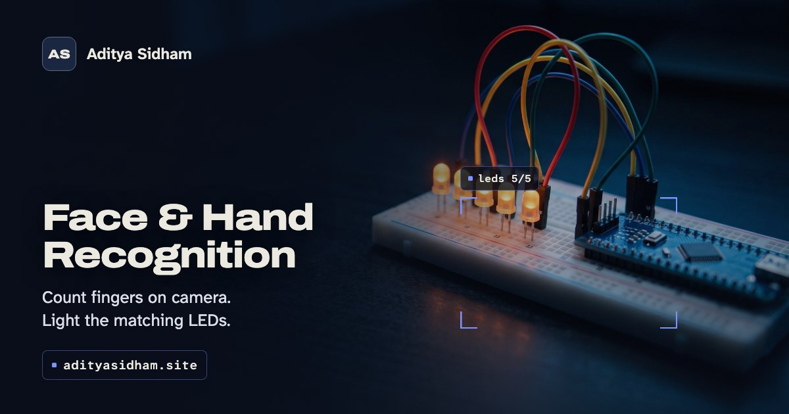</a>
      <h3>Face &amp; Hand Recognition</h3>
      <sub><b>Computer vision, 2021</b></sub>
      <p>Count raised fingers on camera and light the matching LEDs through an Arduino. My first complete loop from seeing to doing.</p>
    </td>
    <td width="50%" valign="top">
      <a href="https://adityasidham.site/RoboticArm.html">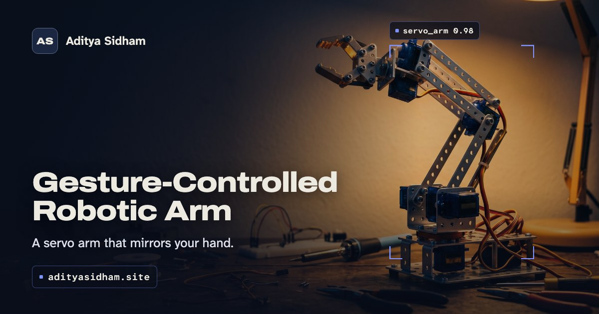</a>
      <h3>Gesture-Controlled Robotic Arm</h3>
      <sub><b>Robotics, 2018, Maker of the Month</b></sub>
      <p>A servo arm that mirrors your hand through a gyroscope. The project that started my habit of building things.</p>
    </td>
  </tr>
</table>

<p align="right"><a href="#readme-top">Back to top</a></p>

## How the hero works

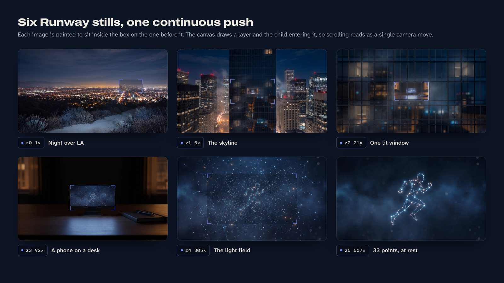

The hero is one `<canvas>` and six still images. Each image was generated with Runway around the one inside it, so every layer contains the next. Scrolling moves a camera through them, and the page never plays a video.

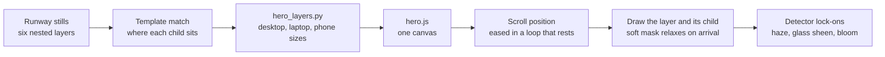

- **Built inside out.** The runner came first. Every outer layer was outpainted around the one before it, then measured with template matching, because the model never keeps exact placement.
- **One camera move.** The view rectangle shrinks geometrically toward each child's box, so every push lands exactly on the next full frame. Only two layers are drawn per frame, sampled straight from their source pixels.
- **Seams that disappear.** The entering layer fades in through a soft oval or rectangular mask that relaxes to nothing by arrival, so every frame you stop on is the clean image.
- **The camera sees first.** Before each push, a detector box locks onto the next target (`downtown_la 0.98`, `window_21f 0.94`, `phone 0.97`) and then rides the push.
- **Captions paced in scroll distance.** An 840vh hero, an eased hold under every caption, and a scrim measured against each caption's brightest frame.
- **A still mode that is designed, not a fallback.** Reduced motion and short landscape phones get a composed still hero, decided live from media queries. If the images fail to load, the captions still play over the poster.

<p align="right"><a href="#readme-top">Back to top</a></p>

## Inside the site

<table>
  <tr>
    <td width="50%" valign="top">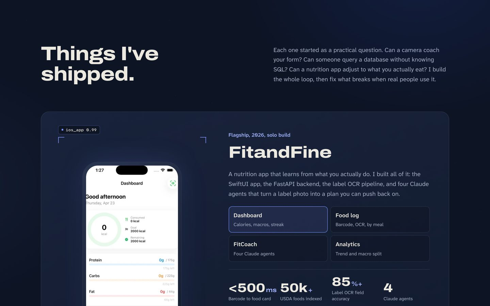<br><b>Things I've shipped.</b> The FitandFine showcase, with a real tab list for its screens.</td>
    <td width="50%" valign="top">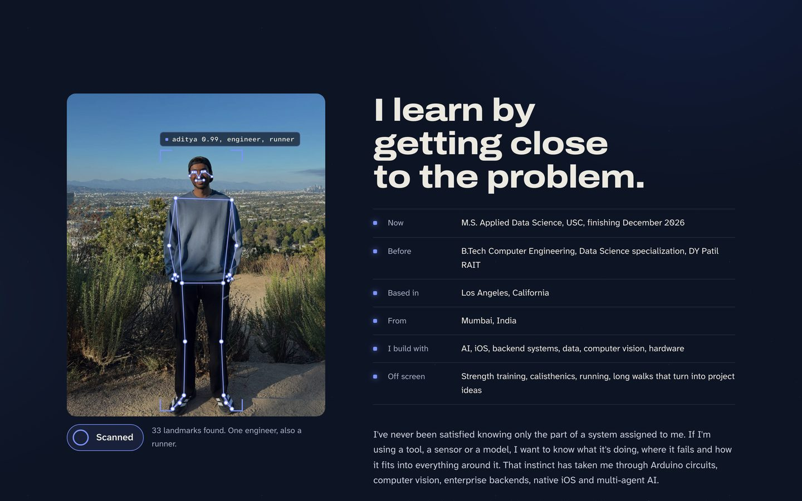<br><b>Hold to scan.</b> Press and hold the photo: 33 pose landmarks find me, the skeleton draws, and the facts beside it light up.</td>
  </tr>
  <tr>
    <td width="50%" valign="top">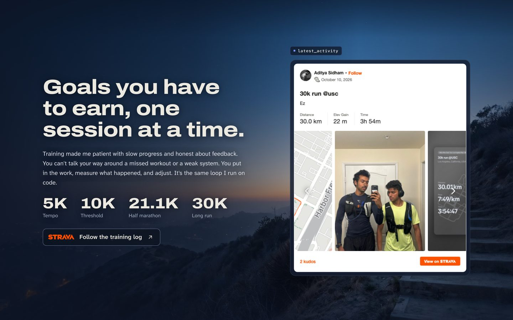<br><b>Training.</b> A blue-hour Runway still and a live Strava embed of my latest 30K run.</td>
    <td width="50%" valign="top">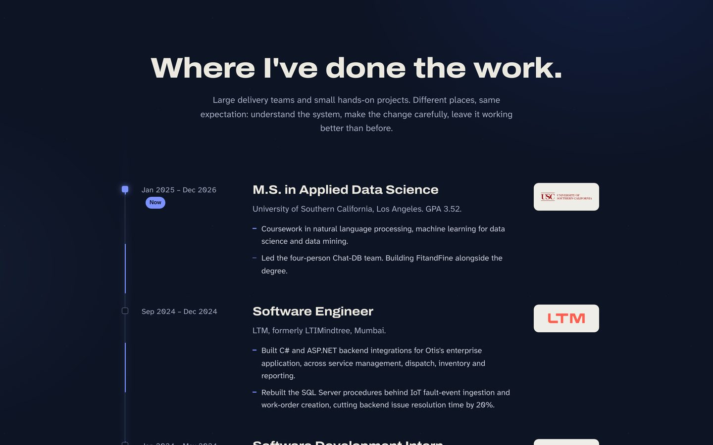<br><b>Experience.</b> A trail that draws itself as you scroll, with logos sized by visual weight.</td>
  </tr>
  <tr>
    <td width="50%" valign="top">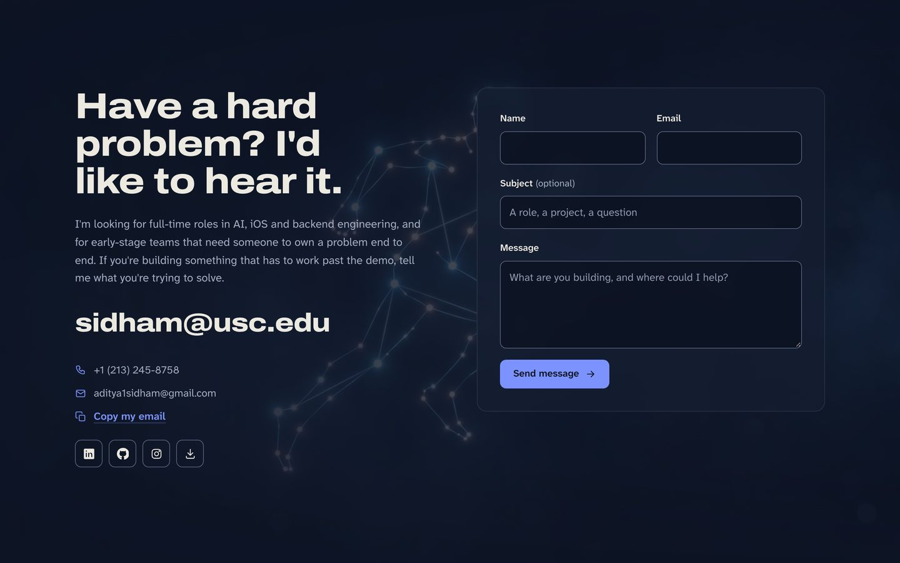<br><b>Contact.</b> The hero's resting frame returns behind the form.</td>
    <td width="50%" valign="top">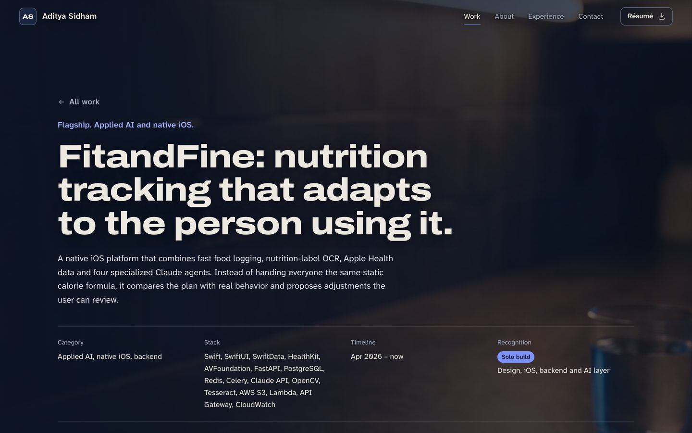<br><b>Case studies.</b> Six pages, each with a Runway header and the real screenshots untouched below.</td>
  </tr>
</table>

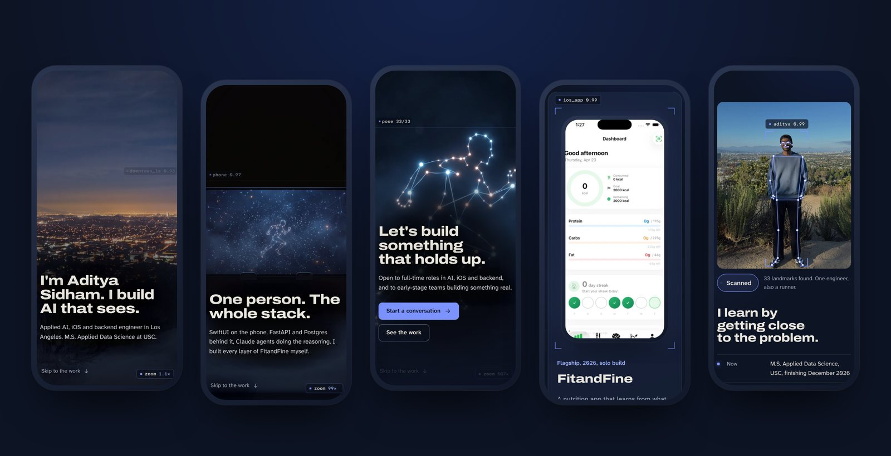

<p align="center"><sub>On phones the zoom still runs, from portrait crops of each layer that stay sharp on tall screens.</sub></p>

<p align="right"><a href="#readme-top">Back to top</a></p>

## Design system

One idea runs the page: a vision model ignores almost everything in a noisy frame and keeps the few points that matter. The detector brackets, the readout chips and the hero's lock-ons all come from it. The full brief, band map and copy live in [`.build/design-package.md`](.build/design-package.md).


| Role | Choice |
|---|---|
| Display | Archivo, expanded width, 700 to 800 |
| Body | Atkinson Hyperlegible Next, built for legibility |
| Machine readouts | Atkinson Hyperlegible Mono, only for detector chips |
| Accent | The call to action, focus rings and the detector. Nowhere else. |
| Canvas | Night blue, never pure black. City-light amber lives only inside the imagery. |

<p align="right"><a href="#readme-top">Back to top</a></p>

## Receipts

Measured, not estimated.

| What | Result |
|---|---|
| Homepage HTML, CSS and JS | 34 KB gzipped, total |
| Hero images | 892 KB on desktop, 404 KB on smaller laptops, 491 KB on phones |
| Video | None |
| Live load | Page loaded in 0.71 s with the zoom ready at 0.78 s on a cold desktop load, 0.35 s and 0.42 s at phone size (headless Chrome, cache off, fast connection) |
| Caption contrast | 4.2:1 or better against the brightest frame, at 1440, 1280 and 1024 wide and on 375, 390 and 430 phones |
| Scroll pacing | Every caption stays fully readable for 6 to 7 normal scroll flicks, and none can be skipped |
| Reduced motion | Still hero, zero zoom images downloaded, can be switched on or off while the page is open |
| Console errors | 0 across all 7 pages at desktop and phone sizes |
| Runtime dependencies | 0 |

<p align="right"><a href="#readme-top">Back to top</a></p>

## Tech stack

**Site**&nbsp;&nbsp;


**Pipeline**&nbsp;&nbsp;


**Hosting**&nbsp;&nbsp;


<p align="right"><a href="#readme-top">Back to top</a></p>

## Project structure

```text
Adi_Portfolio/
├── index.html                 Home (generated)
├── FitandFine.html ...        Six case studies (generated)
├── 404.html                   Styled, self-contained, served from any path
├── assets/
│   ├── css/style.css          Tokens, hero, sections, case studies
│   ├── js/hero.js             The zoom: canvas renderer, captions, live gates
│   ├── js/main.js             Nav, reveals, trail, scan, tabs, form
│   ├── img/hero/              Six zoom layers in three sizes, posters
│   ├── img/og/                Social cards for every page
│   └── img/web/               Photos, screenshots, Runway section stills
├── .build/
│   ├── index_template.html    Homepage source
│   ├── build_index.py         Asset version, site address, hero geometry
│   ├── projects_data.py       All case-study copy
│   ├── build_projects.py      Case-study template and renderer
│   ├── hero_layers.py         Exports the zoom layers (needs Pillow)
│   ├── og_cards.mjs           Renders social cards and app icons
│   └── design-package.md      The brief behind every decision
└── .github/readme/            Images for this README
```

<p align="right"><a href="#readme-top">Back to top</a></p>

## Run it locally

```bash
git clone https://github.com/AdityaSidham/Adi_Portfolio.git
cd Adi_Portfolio
python3 -m http.server 8765
```

Then open **http://localhost:8765**. Opening `index.html` directly also works.

<details>
<summary><b>Rebuilding after an edit</b></summary>

<br>

Pages are generated, so edit the sources in `.build/` rather than the HTML.

```bash
python3 .build/build_index.py      # index.html
python3 .build/build_projects.py   # the six case studies
node .build/og_cards.mjs           # social cards and app icons
```

After any CSS, JS or image change, bump `V` in `.build/build_index.py` and rebuild, so browsers fetch fresh files. Numbers on the site come from [`assets/resume/Aditya_Sidham_Resume.pdf`](assets/resume/Aditya_Sidham_Resume.pdf). FitForm is a published patent application, so the copy says "patent-pending", never "patented".

</details>

<details>
<summary><b>Things worth knowing before you edit</b></summary>

<br>

- **The zoom geometry is measured.** Each layer's `box` in `build_index.py` is where the next image sits inside it. Swap a layer image and re-measure, or the push will jump.
- **Never put `overflow-x: hidden` alone on `body`.** It breaks anchor links and sticky positioning. The stylesheet uses `clip`, with `hidden` as the fallback.
- **The Strava embed is pinned to one activity.** Swap `data-embed-id` and `data-token` in the template to feature another.
- **The contact form** posts to Formspree once `YOUR_FORM_ID` in the template is replaced. Until then it opens the visitor's email app with the message filled in.
- **Hosting.** Every push to `main` deploys to adityasidham.site on Netlify and to GitHub Pages. Pages is case-sensitive, so check filename casing before pushing.

</details>

<p align="right"><a href="#readme-top">Back to top</a></p>

## Credits

- Scene imagery generated with [Runway](https://runwayml.com). Every photo of me and every product screenshot is real.
- Type: [Archivo](https://fonts.google.com/specimen/Archivo) and [Atkinson Hyperlegible](https://fonts.google.com/specimen/Atkinson+Hyperlegible+Next), served by Google Fonts.
- Training data from my own [Strava](https://www.strava.com/athletes/186930143) log.

## Contact

Have a hard problem? I'd like to hear it.

<a href="mailto:sidham@usc.edu"></a>
<a href="https://www.linkedin.com/in/adityasidham/"></a>
<a href="https://github.com/adityasidham"></a>
<a href="assets/resume/Aditya_Sidham_Resume.pdf"></a>

<br>

<div align="center">
<sub>Designed and built by Aditya Sidham in Los Angeles.</sub>
<br>
<sub><a href="#readme-top">Back to top</a></sub>
</div>
